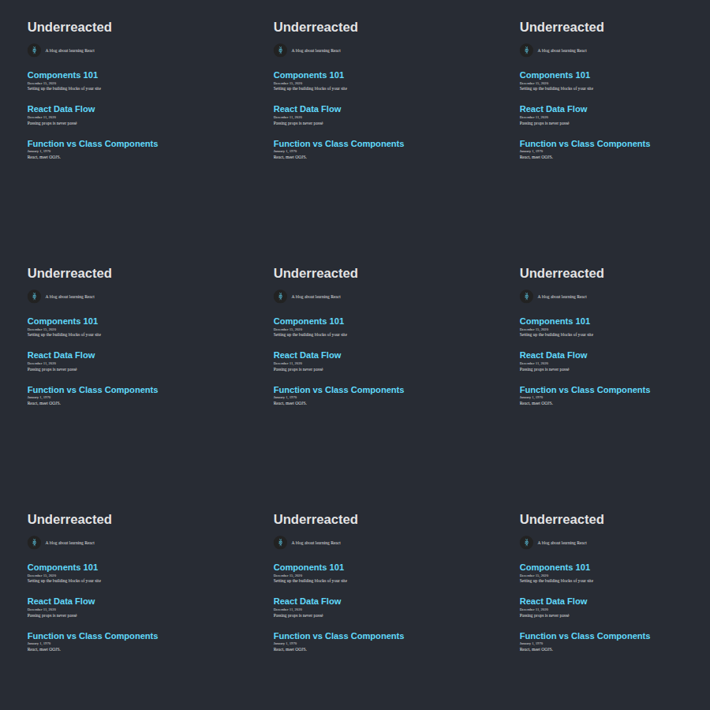

# Personal Blog

A small React blog built with Vite. Blog content lives in `src/data/blog.js` and
is passed through the component tree as props.

## Run the project

Requirements: Node.js and npm.

```bash
npm install
npm run dev
```

Open the local URL printed by Vite (usually `http://localhost:5173`).

Useful commands:

```bash
npm test -- --run
npm run build
npm run preview
```

## Blog screenshot



## Components and connections

```text
App
├── Header
├── About
└── ArticleList
    └── Article (one per post)
```

| Component | Purpose | Connected to |
| --- | --- | --- |
| `App` (`src/components/App.jsx`) | Loads blog data and assembles the page. | Parent of `Header`, `About`, and `ArticleList`. |
| `Header` (`src/components/Header.jsx`) | Displays the blog name in a heading. | Child of `App`; receives `name`. |
| `About` (`src/components/About.jsx`) | Displays the accessible blog image and description. | Child of `App`; receives `image` and `about`. |
| `ArticleList` (`src/components/ArticleList.jsx`) | Renders the list of blog posts. | Child of `App`; creates an `Article` for each post. |
| `Article` (`src/components/Article.jsx`) | Displays one post's title, date, and preview. | Child of `ArticleList`; receives fields from a post. |

This project uses `App`, `Header`, and `ArticleList`; it does not currently have
`Home.jsx` or `Links.jsx` components.
